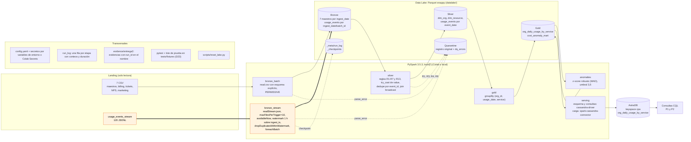

# Arquitectura v2 (entrega 2)

| | |
|---|---|
| **Versión** | v2.0 (13/11/2026) |
| **Reemplaza a** | Diagrama v1.0 del [documento de diseño](diseno_entrega1.md#41-diagrama-v10-04102026) (04/10/2026) |
| **Alcance** | Solo lo que está implementado y corre en el notebook [`01_pipeline_entrega2.ipynb`](../notebooks/01_pipeline_entrega2.ipynb) |

El patrón sigue siendo híbrido (D1): Structured Streaming solo ingesta los eventos en Bronze; los maestros entran en batch, y Silver y Gold se recalculan en batch sobre Bronze. A AstraDB llega solo el mart FinOps de Gold.

## Diagrama

En naranja y con flechas gruesas está el camino streaming; el resto es batch. Las líneas punteadas son los registros que van a quarantine y el estado del stream.

## Componentes

| Capa | Componente | Código | Qué hace | Decisiones |
|---|---|---|---|---|
| Configuración | `config` | [`src/cpa/config.py`](../src/cpa/config.py), [`config/config.example.yaml`](../config/config.example.yaml) | Rutas del lago resueltas contra la raíz del repo, parámetros de cada etapa y secretos por variables de entorno | D22 |
| Sesión | `spark_session` | [`src/cpa/spark_session.py`](../src/cpa/spark_session.py) | UTC, `shuffle.partitions=8`, overwrite dinámico de particiones y, solo para serving, el conector de Cassandra | D2, D7 |
| Ingesta batch | `bronze_batch` | [`src/cpa/bronze_batch.py`](../src/cpa/bronze_batch.py) | Las 7 fuentes CSV a `bronze/<fuente>/ingest_date=D/`, un archivo por partición; las filas ilegibles a quarantine | D6, D7 |
| Ingesta streaming | `bronze_stream` | [`src/cpa/bronze_stream.py`](../src/cpa/bronze_stream.py) | 120 JSONL en 12 micro-lotes a `bronze/usage_events/ingest_date=D/batch_id=N/`, con deduplicación por `dedupe_key` y checkpoint | D4, D5 |
| Calidad | `quality` | [`src/cpa/quality.py`](../src/cpa/quality.py) | Una función por regla; bloqueantes en `dq_errors`, el resto como flags | D8, D13, D15, D18, D21 |
| Silver | `silver` | [`src/cpa/silver.py`](../src/cpa/silver.py) | `dim_org` y `dim_resource` (último snapshot), `usage_events` con join broadcast, dedupe por `event_id` y quarantine | D6, D12, D14 |
| Gold | `gold` | [`src/cpa/gold.py`](../src/cpa/gold.py) | `org_daily_usage_by_service`, grano único, conciliación de costo contra Silver | A2 |
| Analítica | `anomalies` | [`src/cpa/anomalies.py`](../src/cpa/anomalies.py) | `cost_anomaly_mart` con z-score robusto y sensibilidad al umbral | D11, D24 |
| Serving | `serving` | [`src/cpa/serving.py`](../src/cpa/serving.py), [`cql/`](../cql/) | Esquema CQL, carga por upsert y consultas P1 y P2 | D9, D25 |
| Orquestación | `pipeline` y notebook | [`src/cpa/pipeline.py`](../src/cpa/pipeline.py), [`notebooks/01_pipeline_entrega2.ipynb`](../notebooks/01_pipeline_entrega2.ipynb) | Etapas en orden, comparación de zonas entre dos corridas | D10 |
| Observabilidad | `run_log`, `evidence` | [`src/cpa/run_log.py`](../src/cpa/run_log.py), [`src/cpa/evidence.py`](../src/cpa/evidence.py) | Una fila por etapa (leídas, escritas, rechazadas, duplicadas, duración, estado) y evidencias que no se pisan | |

## Qué cambió respecto de la v1

| Tema | v1 (diseño) | v2 (implementado) | Por qué |
|---|---|---|---|
| Persistencia en Colab | Copiar el lago y los checkpoints a Drive y restaurarlos | El lago se regenera desde Landing en cada sesión; solo la evidencia queda en el repo | D22: con la muestra regenerar es rápido y copiar cientos de archivos chicos a Drive es lento y frágil |
| Serving | Conector para todo | El conector carga el mart; `cassandra-driver` ejecuta el esquema y las consultas | D25: el conector escribe DataFrames, pero el esquema y P1/P2 son CQL |
| Silver | `usage_events`, dimensiones, `billing` y `tickets` | `usage_events`, `dim_org` y `dim_resource` | Alcance mínimo de la entrega 2; el resto está en el backlog |
| Gold y AstraDB | 6 marts y 5 tablas | 2 tablas en Gold (`org_daily_usage_by_service` y `cost_anomaly_mart`) y 1 en AstraDB | Alcance mínimo de la entrega 2 (consigna 6.2) |
| Anomalías | Para la entrega final | Implementadas en Gold, solo en Parquet | El componente analítico vale en esta entrega (D24) |
| Quarantine | Con los datos reales | Con los datos reales queda vacía; las muestras salen de un lote de prueba aparte | D23: la muestra no tiene errores bloqueantes |

## Vistas física y de despliegue

| Vista | Entrega 2 |
|---|---|
| Física | Parquet snappy en `datalake/` (disco local de Colab o de la máquina), Spark 3.5.3 en `local[*]` con Java 17, AstraDB Serverless (AWS us-east-2) |
| Despliegue | Un notebook que se corre a mano. En Colab clona el repo, instala `requirements.txt` y toma los secretos de Colab Secrets; en local, de variables de entorno |
